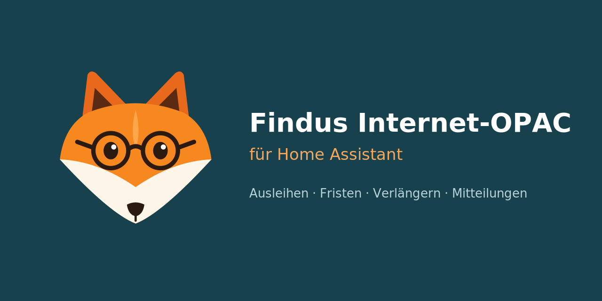
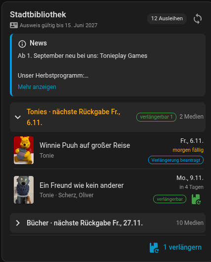
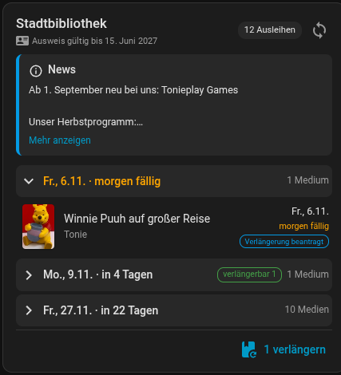

# Findus Library for Home Assistant

[Deutsch](README.md) | **English**



Keep track of what you borrowed from your library – books, Tonies, CDs, films and games.
Home Assistant shows what is due when, reminds you in time and can renew automatically.

> Unofficial. This project is not affiliated with Findus or any library.

## What you get

- **Dashboard overview:** a card with covers, due dates and renew buttons, coloured by
  urgency.
- **Reminders on your phone:** a daily message when something is due soon, due today or
  overdue – with a **Renew** button right in the notification.
- **Renew with one tap** – or fully automatically shortly before the due date.
- **Reasons, not guesswork:** why an item cannot be renewed (e.g. "renewal limit reached" or
  "reserved").
- **Library announcements** such as holiday closures or events.
- **Opening hours:** whether the library is open now, and a warning when it is closed on a
  due date.
- **Calendar:** due dates in the Home Assistant calendar.
- **Data date:** when the library last updated its data.
- **Card expiry:** a heads-up 30 and 7 days before your library card expires.
- **Several cards**, e.g. one per family member.

## Does it work with my library?

Yes, if your library's online catalogue runs on **Findus Internet-OPAC** – more than 200
libraries in Germany use it. You can tell by the catalogue address:
`https://<name>.findus-internet-opac.de`. All libraries are listed on the
[Findus reference page](https://www.findus-internet-opac.de/referenzen).

You also need:

- Home Assistant **2025.6** or newer
- your **library card number** and your **birth date or password** – the same as for the
  library website login

## Installation

### With HACS (recommended)

[](https://my.home-assistant.io/redirect/hacs_repository/?owner=ben-epp&repository=ha-findus-opac&category=integration)

Or by hand:

1. In Home Assistant open **HACS** → menu (⋮) → **Custom repositories**.
2. Enter `https://github.com/ben-epp/ha-findus-opac`, type **Integration**, add.
3. Search for **Findus Internet-OPAC**, **Download**.
4. **Restart** Home Assistant.

HACS will then show you updates automatically.

### Without HACS

Copy the folder `custom_components/findus_opac` from the
[latest release](https://github.com/ben-epp/ha-findus-opac/releases/latest) into
`config/custom_components/` of your Home Assistant and restart. You then have to install
updates yourself.

## Setup

[](https://my.home-assistant.io/redirect/config_flow_start/?domain=findus_opac)

Or: **Settings → Devices & services → Add integration → Findus Internet-OPAC**

| Field | Example | What to enter |
|---|---|---|
| Account name | `Lena` | A display name, e.g. whose card it is |
| Library subdomain | `alzey` | The part before `.findus-internet-opac.de` – or just the full catalogue address |
| Card number | `12345678` | The number on your library card |
| Birth date or password | `DD.MM.YYYY` | Exactly as you log in on the library website |

For each further card, simply add the integration again. If your password changes, Home
Assistant asks for the new one by itself.

## Dashboard card

The card ships with the integration – nothing extra to install. Edit dashboard →
**Add card** → **"Findus Bibliothek"**. It finds your account by itself; everything else is
set in the card editor.

<table>
  <tr>
    <td></td>
    <td></td>
  </tr>
  <tr>
    <td align="center">Grouped by media type</td>
    <td align="center">Grouped by due date</td>
  </tr>
</table>

What the card shows:

- cover, title and due date of every item – red when overdue, orange when due soon
- "renewable" with a renew button per item, or the reason why not
- a button to renew everything renewable and one to sync right away
- your card's expiry and the library's current announcement (expandable)
- whether the library is open now, with all hours expandable
- the library's data date, in orange when it is older than 4 days

<details>
<summary>Card options (YAML)</summary>

```yaml
type: custom:findus-opac-card
entity: sensor.lena_loans
title: Lena's library       # default: account name
show_renew: true            # renew buttons
show_covers: true           # cover images
show_card_expiry: true      # library card expiry
show_announcement: true     # library announcement
show_hours: true            # opening hours
show_last_sync: true        # library data date
max_items: 0                # show at most this many items; 0 = all
warn_days: 3                # orange from this many days before the due date
group_by: due               # due (by date) | category (by media type) | none
max_height: 400             # list height in px, scrollable beyond; 0 = unlimited
```

</details>

If the card looks unchanged after an update, reload the page without cache (Ctrl+Shift+R; in
the app: Companion app settings → clear frontend cache).

## Reminders on your phone

**Settings → Devices & services → Findus Internet-OPAC → Configure**

1. Under **Notify**, pick your phone (e.g. `mobile_app_my_phone` from the Home Assistant
   app).
2. Choose a **time** for the daily overview (default 08:00).
3. Under **Notify about**, pick what you want to hear about.

You get at most one message per day and card – and only when there is something new:

| Occasion | When | How often |
|---|---|---|
| Due soon | within the next days (default 3) | once per item |
| Due today | on the due date | once per item |
| Overdue | after the due date | daily until returned |
| Renewal | right after every renewal | every time |
| Last chance | on the last opening day before a closed due date, only if the item cannot be renewed | once per item |
| Card expires | 30 and 7 days before | once each |

It looks like this:

```text
Library: Lena
Overdue for 2 days: 1 item
Due today: 1 item
Due Sun 8 Nov: 1 item
```

Titles only appear if you switch on **Show titles in notifications**:

```text
Library: Lena
Overdue for 2 days: Whales & Dolphins (renewal limit reached)
Due today: The Little Dragon (renewable)
Due Sun 8 Nov: Sing-along Songs (renewable)
```

In the Home Assistant app (Android and iOS) the message has a **Renew** button as soon as
something is renewable. Other services such as e-mail or Telegram get the text only.

The last chance uses the regular opening hours. They can differ on holidays and during
closures, and the message says so too.

## Automatic renewal

Under **Configure** you can switch on **Auto-renew**. The integration then requests
the renewal by itself when an item is due soon and renewable – once per item.

- **Auto-renew window** (default 2 days): renew this many days before the due date.
- **Auto-renew only**: limit it to certain media types, e.g. only Tonies and CDs. Empty = all.
- **Email for renewal confirmations** (optional): the library sends its confirmation of each
  renewal request to this address – as when renewing on its website. Applies to every renewal,
  including the buttons.

The same dialog also has the **Update interval** (default every 6 hours) and the **Due soon
window** (default 3 days).

Tip: the new loan period usually starts **on the day you renew**, not on the old due date.
Renewing early wastes loan time – shortly before is better.

## Good to know

- **The data is a few hours old.** Findus mirrors the library's own system, which uploads
  several times a day. Something you just returned at the desk may stay on the list for a
  while. Polling more often doesn't help.
- **Renewing is a request.** The library accepts it right away, but the new due date often
  appears only after its next sync. Until then the item shows "renewal requested".
- **Not everything can be renewed.** The library decides: usually only from 14 days before
  the due date, not when reserved, and only 2–3 times per item. The card shows the reason
  right at the item.
- **Library announcements** are free text. Whether one is about a closure is guessed from
  words like "geschlossen" (closed) or "Urlaub" (holiday) – right most of the time, not
  always. Long announcements are shortened; the link leads to the full text.
- **Opening hours** are the regular times from your library's page, as on a maps service: they
  can differ on holidays and during closures, and "Open now" does not know about those. If a day
  has a remark such as "every first Saturday of the month", the sensor shows "unknown" that day
  and no last chance is worked out from it. Not every library lists hours; the sensor is then
  unavailable.
- **Calendar:** an event's title only gives the count, the item titles are in its description.
  That keeps them out of Home Assistant's history.
- **Cover images** are loaded by your browser directly from Findus; your credentials are not
  sent. If you prefer not to, switch covers off in the card.
- **Languages:** German and English, following your Home Assistant language. Titles and notes
  from the library stay as the library wrote them.

## Entities

Each card gets a device with these entities. Entity IDs start with the account name, e.g.
`sensor.lena_loans` – the exact IDs are on the device page.

| Entity | Content |
|---|---|
| Loans | Number of all loans, with every item in the attribute `items` |
| Books, Tonies, CDs, Videos, Games | Count per media type (videos and games are hidden at first) |
| Next due date / Days until next due | Earliest due date and the days until then (negative = overdue) |
| Due today / Due soon / Overdue / Renewable | Number of such items |
| Library card valid until | Expiry date of your library card |
| Library announcement | Title of the current announcement, empty if none |
| Library data from | When the library last updated its data |
| Open now (regular hours) | On/off, with the hours in the attributes `hours`, `closes_at`, `next_open`, `note` |
| Due dates | Calendar with one all-day event per due date |
| Overdue items / Renewal possible / Library card expires soon | On/off – handy for automations |
| Renew all | Button: renew all renewable items |
| Sync now | Button: read the account again right away |

<details>
<summary>Attributes for your own cards and templates</summary>

Each item in `items`:

| Attribute | Meaning |
|---|---|
| `title`, `author`, `media_type` | Title, author, media type as named by the library |
| `category` | `book`, `tonie`, `cd`, `video` or `game` |
| `due`, `days_left` | Due date and days until then |
| `renewable`, `renew_requested` | renewable / renewal requested |
| `renew_block` | Why not renewable: `limit` (limit reached), `reserved`, `too_early`, `other` |
| `note` | The library's note, verbatim |
| `cover`, `series`, `mednr` | Cover URL, series, item number |

Library announcement: `text`, `kind` (`closure` or `info`), `truncated`, `url`, `images`.

</details>

<details>
<summary>For automations: action and event</summary>

Renew via action – without options everything renewable, otherwise only certain items or
media types:

```yaml
action: findus_opac.renew
data:
  config_entry_id: 0123456789abcdef0123456789abcdef
  categories: [tonie, cd]    # optional
  media_ids: ["0900000101"]  # optional
```

After every renewal (including automatic ones) the event `findus_opac_renewal` fires with
`account_name`, `trigger` (`manual` or `auto`) and per item `title`, `old_due`, `new_due` and
`status` (`renewed`, `requested` or `failed`).

Example – spoken reminder the evening before:

```yaml
automation:
  - alias: Library – announce items due tomorrow
    triggers:
      - trigger: time
        at: "18:30:00"
    conditions:
      - condition: numeric_state
        entity_id: sensor.lena_days_until_next_due
        below: 2
    actions:
      - action: tts.speak
        target:
          entity_id: tts.home_assistant_cloud
        data:
          media_player_entity_id: media_player.kitchen
          message: >
            {{ states('sensor.lena_due_soon') }} items are due at the library tomorrow.
```

</details>

## Problems?

- **"Login failed":** check your credentials on the library website – they must work there
  the same way.
- **Card missing or outdated:** restart Home Assistant and reload the page without cache
  (see [Dashboard card](#dashboard-card)).
- **Report a bug:** on the device page choose **Download diagnostics** (it leaves out
  credentials, names and titles, but shows your library's name) and open an [issue](https://github.com/ben-epp/ha-findus-opac/issues) with a short
  description.

## Privacy

- Card number and birth date/password stay in your Home Assistant.
- Home Assistant only contacts your library's Findus server.
- Your browser also loads cover images from Findus servers (the address can contain the ISBN)
  and images from library announcements, which can be hosted elsewhere. Both can be switched
  off in the card.
- Card number and birth date/password are stored unencrypted in the `.storage` folder, as with
  other integrations, so unencrypted backups contain them.
- All users of your Home Assistant can see the loans of every card.
- With titles switched on in notifications, they appear on the lock screen and pass through
  the service you use (Google, Apple, Telegram, e-mail).
- The `findus_opac_renewal` event contains titles and the account name and ends up in Home
  Assistant's history.
- If you enter an email for renewal confirmations, it goes to the library with every renewal
  request.

## License

MIT – see [LICENSE](LICENSE). The fox icon is an original drawing, not the Findus logo.
