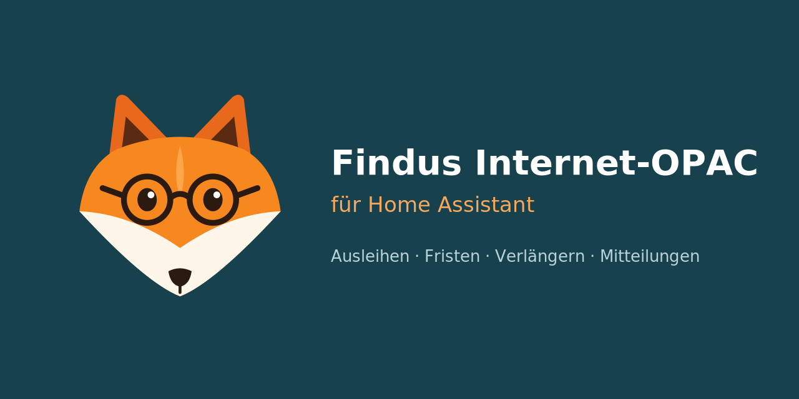
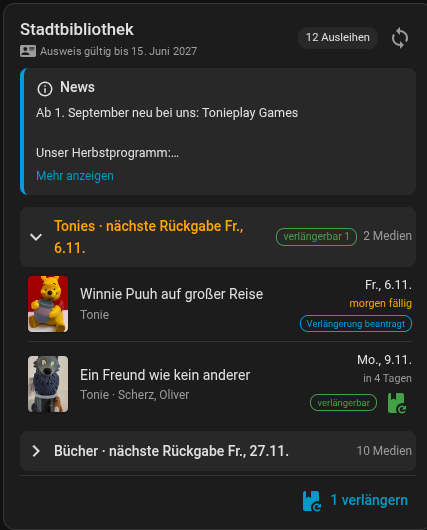
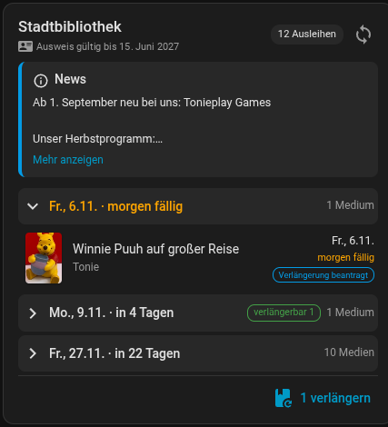
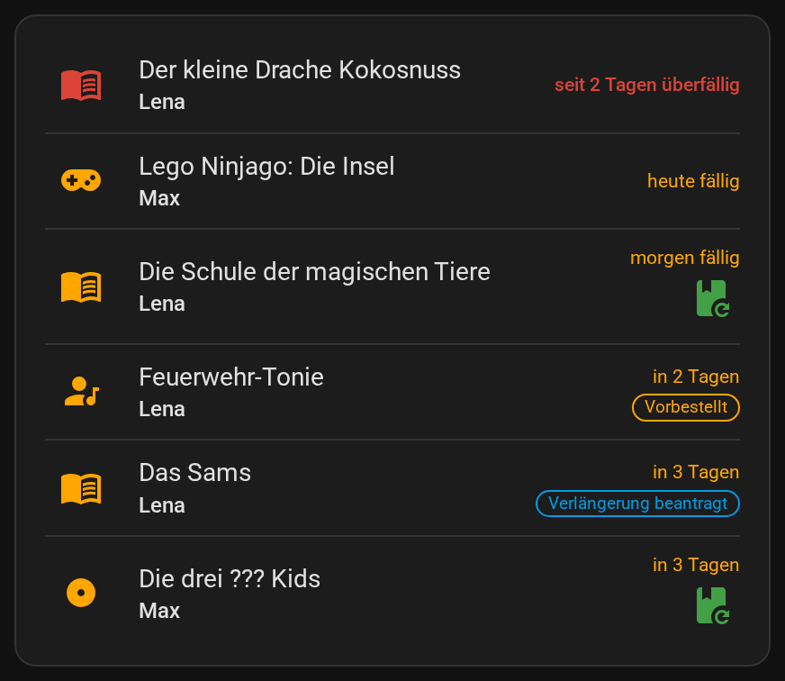
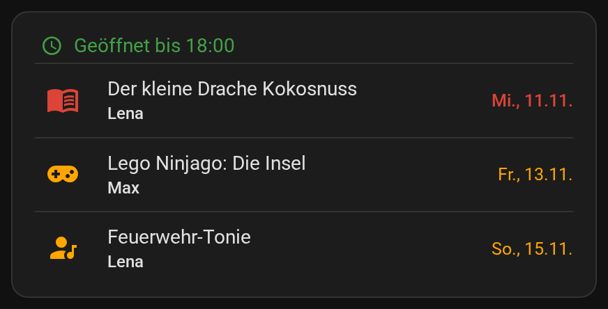
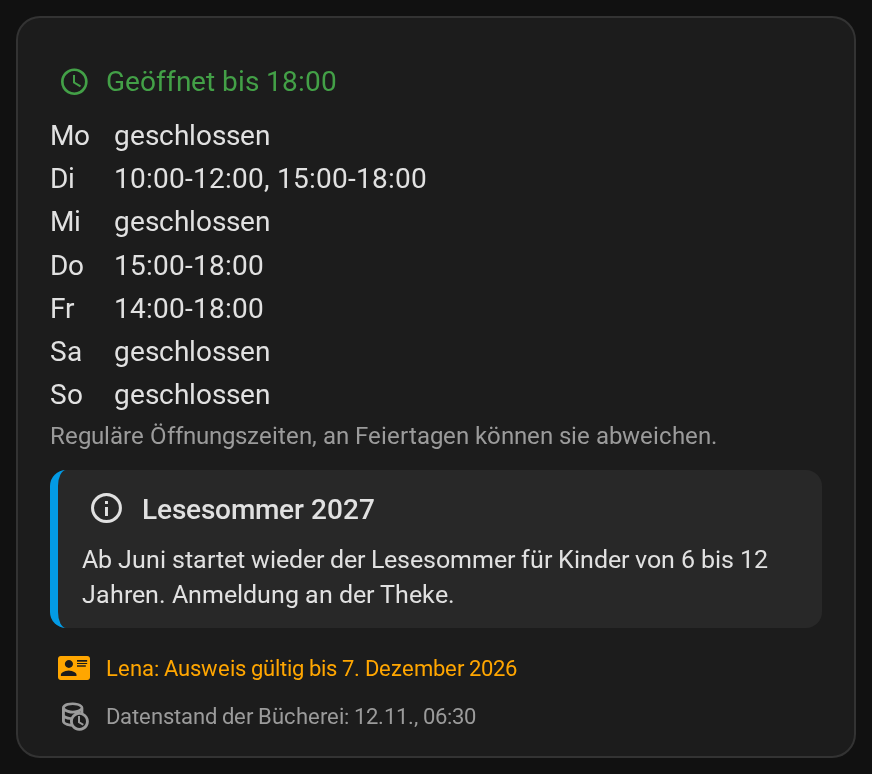
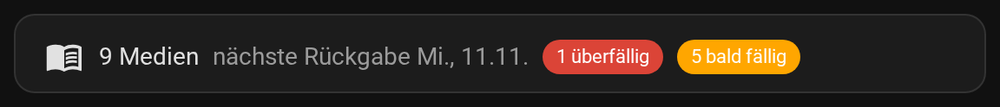

# Findus Bibliothek für Home Assistant

**Deutsch** | [English](README.en.md)



Behalte die Ausleihen deiner Bücherei im Blick – Bücher, Tonies, CDs, Filme und Spiele.
Home Assistant zeigt dir, was wann zurück muss, erinnert dich rechtzeitig und verlängert auf
Wunsch automatisch.

> Inoffiziell. Dieses Projekt steht in keiner Verbindung zu Findus oder den Büchereien.

## Was du bekommst

- **Übersicht im Dashboard:** eigene Karte mit Coverbildern, Rückgabedaten und
  Verlängern-Knöpfen, farbig nach Dringlichkeit.
- **Erinnerungen aufs Handy:** tägliche Nachricht, wenn etwas bald oder heute fällig oder
  überfällig ist – mit Knopf „Verlängern“ direkt in der Nachricht.
- **Verlängern mit einem Tipp** – oder ganz automatisch kurz vor der Rückgabe.
- **Gründe statt Rätsel:** warum etwas nicht verlängert werden kann (z. B. „Verlängerungen
  ausgeschöpft“ oder „vorbestellt“).
- **Mitteilungen der Bücherei** wie Urlaubsschließungen oder Veranstaltungen.
- **Öffnungszeiten:** ob gerade offen ist, und eine Warnung, wenn die Bücherei am Rückgabetag
  geschlossen hat.
- **Kalender:** Rückgabetermine im Kalender von Home Assistant.
- **Datenstand:** wann die Bücherei zuletzt ihre Daten aktualisiert hat.
- **Ausweis-Ablauf:** Hinweis 30 und 7 Tage, bevor der Bibliotheksausweis abläuft.
- **Mehrere Ausweise**, z. B. einer pro Familienmitglied – auf Wunsch alle auf einer Karte.

## Funktioniert das mit meiner Bücherei?

Ja, wenn deine Bücherei ihren Online-Katalog über **Findus Internet-OPAC** anbietet – über
200 Büchereien in Deutschland tun das. Du erkennst es an der Adresse des Katalogs:
`https://<name>.findus-internet-opac.de`. Die Liste aller Büchereien steht auf der
[Referenzseite von Findus](https://www.findus-internet-opac.de/referenzen).

Du brauchst außerdem:

- Home Assistant **2025.6** oder neuer
- deine **Ausweisnummer** und dein **Geburtsdatum oder Passwort** – dieselben Daten wie
  beim Login auf der Webseite der Bücherei

## Installation

### Über den Marketplace (empfohlen)

Seit Home Assistant 2026.11 ist HACS als **Marketplace** fest eingebaut.

[](https://my.home-assistant.io/redirect/hacs_repository/?owner=ben-epp&repository=ha-findus-opac&category=integration)

Oder von Hand:

1. **Einstellungen → Marketplace** öffnen. Beim ersten Mal den Hinweis bestätigen.
2. Nach **Findus** suchen und **Findus Internet-OPAC** öffnen.
3. **Installieren** wählen und im Dialog noch einmal **Installieren** bestätigen.
4. Meist öffnet sich gleich die [Einrichtung](#einrichtung). Fragt der Marketplace nach einem
   Neustart, Home Assistant neu starten.

Updates zeigt dir der Marketplace danach automatisch an.

### Mit HACS (bis Home Assistant 2026.10)

In **HACS** nach **Findus Internet-OPAC** suchen, **Herunterladen** und Home Assistant
**neu starten**. Der Knopf oben funktioniert hier auch.

### Von Hand

Den Ordner `custom_components/findus_opac` aus dem
[neuesten Release](https://github.com/ben-epp/ha-findus-opac/releases/latest) in den Ordner
`config/custom_components/` deiner Home-Assistant-Installation kopieren und neu starten.
Updates musst du dann selbst einspielen.

## Einrichtung

[](https://my.home-assistant.io/redirect/config_flow_start/?domain=findus_opac)

Oder: **Einstellungen → Geräte & Dienste → Integration hinzufügen → Findus Internet-OPAC**

| Feld | Beispiel | Was eintragen |
|---|---|---|
| Kontoname | `Lena` | Ein Name für die Anzeige, z. B. wem der Ausweis gehört |
| Bücherei-Subdomain | `alzey` | Der Teil vor `.findus-internet-opac.de` – oder einfach die ganze Adresse des Katalogs |
| Ausweisnummer | `12345678` | Die Nummer auf dem Bibliotheksausweis |
| Geburtsdatum oder Passwort | `TT.MM.JJJJ` | Genau so, wie du dich auf der Webseite der Bücherei anmeldest |

Für jeden weiteren Ausweis die Integration einfach noch einmal hinzufügen. Ändert sich das
Passwort, fragt Home Assistant von selbst nach dem neuen.

## Dashboard-Karte

Die Karte wird mit der Integration mitgeliefert – nichts extra installieren. Dashboard
bearbeiten → **Karte hinzufügen** → **„Findus Bibliothek“**. Sie findet dein Konto von
selbst; alles Weitere stellst du direkt im Karten-Editor ein.

<table>
  <tr>
    <td></td>
    <td></td>
  </tr>
  <tr>
    <td align="center">Gruppiert nach Medienart</td>
    <td align="center">Gruppiert nach Rückgabedatum</td>
  </tr>
</table>

Was die Karte zeigt:

- Cover, Titel und Rückgabedatum jedes Mediums – rot bei überfälligen, orange bei bald
  fälligen Medien
- „verlängerbar“ mit Verlängern-Knopf pro Medium, oder den Grund, warum nicht
- einen Knopf zum Verlängern aller verlängerbaren Medien und einen zum sofortigen Abgleich
- die Gültigkeit des Ausweises und die aktuelle Mitteilung der Bücherei (aufklappbar)
- ob die Bücherei gerade geöffnet hat, mit allen Zeiten zum Aufklappen
- den Datenstand der Bücherei, orange, wenn er älter als 4 Tage ist

**Für die ganze Familie:** Wähle im Karten-Editor unter **Weitere Ausleihen-Sensoren** die
Ausweise der anderen Familienmitglieder. Die Karte zeigt dann alle Medien in einer Liste, jedes
mit dem Namen der Person, und lässt sich auch nach Person gruppieren. „Alle verlängern“ und der
Abgleich gelten für alle Ausweise. Öffnungszeiten, Mitteilung und Datenstand erscheinen einmal
pro Bücherei; vom Ausweis nur die, die in den nächsten 30 Tagen ablaufen.

<details>
<summary>Einstellungen der Karte (YAML)</summary>

```yaml
type: custom:findus-opac-card
entity: sensor.lena_ausleihen
entities:                   # weitere Ausweise für die Familienansicht (optional)
  - sensor.max_ausleihen
title: Lenas Bücherei       # Standard: Kontoname, bei der Familie alle Namen
show_renew: true            # Verlängern-Knöpfe
show_covers: true           # Coverbilder
show_card_expiry: true      # Gültigkeit des Ausweises
show_announcement: true     # Mitteilung der Bücherei
show_hours: true            # Öffnungszeiten
show_last_sync: true        # Datenstand der Bücherei
max_items: 0                # höchstens so viele Medien; 0 = alle
warn_days: 3                # orange ab so vielen Tagen vor der Rückgabe
group_by: due               # due (nach Datum) | category (nach Medienart) | account (nach Person) | none
max_height: 400             # Höhe der Liste in px, darüber scrollbar; 0 = unbegrenzt
```

</details>

Siehst du nach einem Update keine Änderung an der Karte, lade die Seite einmal ohne Cache
neu (Strg+Umschalt+R, in der App: Einstellungen der Companion-App → Frontend-Cache leeren).

### Weitere Karten

Neben der großen Karte gibt es vier kleinere für einzelne Fragen. Sie nehmen wie die große
Karte `entity` und optional `entities` für die Familienansicht.

**Zu erledigen:** nur überfällige, heute und bald fällige Medien aus allen Ausweisen, mit
Verlängern-Knopf pro Medium.



```yaml
type: custom:findus-opac-action-card
entity: sensor.lena_ausleihen
entities:                   # optional, für die Familienansicht
  - sensor.max_ausleihen
show_renew: true            # Verlängern-Knöpfe
show_covers: false          # Coverbilder
```

**Zurückbringen:** was auf dem nächsten Weg in die Bücherei mit muss – nicht verlängerbare
Medien, die vor dem übernächsten Öffnungstag fällig werden.



```yaml
type: custom:findus-opac-return-card
entity: sensor.lena_ausleihen
show_covers: false
```

**Bücherei:** Öffnungszeiten, Mitteilung und Ausweis-Gültigkeit ohne Medienliste, einmal
pro Bücherei.



```yaml
type: custom:findus-opac-library-card
entity: sensor.lena_ausleihen
show_hours: true
show_announcement: true
show_card_expiry: true
show_last_sync: true
```

**Kurzübersicht:** eine Zeile mit der Anzahl der Medien, der nächsten Rückgabe und
Warnungen zu überfälligen und bald fälligen Medien.



```yaml
type: custom:findus-opac-chip-card
entity: sensor.lena_ausleihen
title: Lena                # optionaler Text am Anfang der Zeile
```

## Erinnerungen aufs Handy

**Einstellungen → Geräte & Dienste → Findus Internet-OPAC → Konfigurieren**

1. Bei **Benachrichtigen** dein Handy auswählen (z. B. `mobile_app_mein_handy` aus der
   Home-Assistant-App).
2. Eine **Uhrzeit** für die tägliche Übersicht wählen (Standard 08:00).
3. Bei **Benachrichtigen bei** auswählen, worüber du informiert werden willst.

Du bekommst dann höchstens eine Nachricht pro Tag und Ausweis – und nur, wenn es etwas Neues
gibt:

| Anlass | Wann | Wie oft |
|---|---|---|
| Bald fällig | innerhalb der nächsten Tage (Standard 3) | einmal pro Medium |
| Heute fällig | am Rückgabetag | einmal pro Medium |
| Überfällig | nach dem Rückgabetag | täglich, bis es zurück ist |
| Verlängerung | direkt nach jeder Verlängerung | jedes Mal |
| Letzte Chance | am letzten Öffnungstag vor einem geschlossenen Rückgabetag, nur wenn das Medium nicht verlängerbar ist | einmal pro Medium |
| Ausweis läuft ab | 30 und 7 Tage vorher | je einmal |

So sieht das aus:

```text
Bücherei: Lena
Überfällig seit 2 Tagen: 1 Medium
Heute fällig: 1 Medium
Fällig am So., 8.11.: 1 Medium
```

Titel stehen nur in der Nachricht, wenn du **Titel in Benachrichtigungen zeigen** einschaltest:

```text
Bücherei: Lena
Überfällig seit 2 Tagen: Wale & Delfine (Verlängerungen ausgeschöpft)
Heute fällig: Der kleine Drache (verlängerbar)
Fällig am So., 8.11.: Lieder zum Mitsingen (verlängerbar)
```

In der Home-Assistant-App (Android und iOS) hat die Nachricht einen Knopf **„Verlängern“**,
sobald etwas verlängerbar ist. Andere Dienste wie E-Mail oder Telegram bekommen nur den Text.

Die letzte Chance rechnet mit den regulären Öffnungszeiten. An Feiertagen und bei Schließungen
können sie abweichen, darauf weist die Nachricht auch hin.

## Automatisch verlängern

Unter **Konfigurieren** lässt sich **Automatisch verlängern** einschalten. Dann beantragt die
Integration die Verlängerung von selbst, wenn ein Medium bald fällig und verlängerbar ist –
pro Medium nur einmal. Hat sich das Rückgabedatum nach zwei Öffnungstagen der Bücherei noch nicht
verschoben, stellt sie den Antrag ein zweites Mal.

- **Zeitraum für automatisches Verlängern** (Standard 2 Tage): so viele Tage vor der
  Rückgabe wird verlängert.
- **Nur automatisch verlängern**: auf Medienarten beschränken, z. B. nur Tonies und CDs.
  Leer = alle.
- **E-Mail für Verlängerungsbestätigungen** (freiwillig): Die Bücherei schickt ihre Bestätigung
  jedes Verlängerungsantrags an diese Adresse – wie beim Verlängern auf ihrer Webseite. Gilt für
  jede Verlängerung, auch per Knopf.

Im selben Dialog stehen auch das **Aktualisierungsintervall** (Standard alle 6 Stunden) und
der **Zeitraum für „bald fällig“** (Standard 3 Tage).

Tipp: Die neue Leihfrist zählt meist **ab dem Tag der Verlängerung**, nicht ab dem alten
Rückgabedatum. Wer früh verlängert, verschenkt also Leihzeit – kurz vorher ist besser.

## Gut zu wissen

- **Die Daten sind ein paar Stunden alt.** Findus ist nur ein Spiegel des Büchereisystems,
  das mehrmals täglich hochgeladen wird. Was du gerade am Tresen zurückgegeben hast, steht
  vielleicht noch eine Weile in der Liste. Öfter abfragen hilft da nicht.
- **Verlängern ist ein Antrag.** Findus schickt ihn per E-Mail an die Bücherei, und das Personal
  verlängert von Hand während der Öffnungszeiten. Auf der Webseite der Bücherei sieht das Medium
  schon nach dem nächsten Datenabgleich wieder verlängerbar aus, obwohl der Antrag noch
  wartet. Die Integration merkt sich deshalb jeden Antrag und zeigt „Verlängerung beantragt am …“,
  bis sich das Rückgabedatum verschiebt – und stellt ihn bis dahin nicht noch einmal.
- **Nicht alles ist verlängerbar.** Die Bücherei entscheidet: meist erst ab 14 Tagen vor der
  Rückgabe, nicht bei Vorbestellungen und nur 2–3 Mal pro Medium. Den Grund zeigt die Karte
  direkt am Medium.
- **Mitteilungen der Bücherei** sind freier Text. Ob es um eine Schließung geht, errät die
  Integration anhand von Wörtern wie „geschlossen“ oder „Urlaub“ – das klappt meistens, aber
  nicht immer. Lange Mitteilungen werden gekürzt, der Link führt zur ganzen Mitteilung.
- **Öffnungszeiten** sind die regulären Zeiten von der Seite deiner Bücherei, wie bei einem
  Kartendienst: An Feiertagen und bei Schließungen können sie abweichen, „Jetzt geöffnet“ weiß
  davon nichts. Steht bei einem Tag ein Zusatz wie „jeden 1. Samstag im Monat“, zeigt der Sensor
  an diesem Tag „unbekannt“, und die letzte Chance wird dafür nicht berechnet. Nicht jede
  Bücherei trägt Zeiten ein, dann ist der Sensor nicht verfügbar.
- **Kalender:** Der Titel eines Termins nennt nur die Anzahl, die Medientitel stehen in der
  Beschreibung. So landen sie nicht in der Historie von Home Assistant.
- **Coverbilder** lädt dein Browser direkt von Findus; deine Zugangsdaten werden dabei nicht
  übertragen. Wer das nicht möchte, schaltet die Cover in der Karte aus.
- **Sprachen:** Deutsch und Englisch, je nach Sprache von Home Assistant. Titel und Hinweise
  der Bücherei bleiben, wie die Bücherei sie schreibt.

## Entitäten

Pro Ausweis gibt es ein Gerät mit diesen Entitäten. Die Entity-IDs beginnen mit dem
Kontonamen, z. B. `sensor.lena_ausleihen` – die genauen IDs stehen auf der Geräteseite.

| Entität | Inhalt |
|---|---|
| Ausleihen | Anzahl aller Ausleihen, mit allen Medien als Attribut `items` |
| Bücher, Tonies, CDs, Filme, Spiele | Anzahl je Medienart (Filme und Spiele sind anfangs ausgeblendet) |
| Nächste Rückgabe / Tage bis zur Rückgabe | Frühestes Rückgabedatum und die Tage bis dahin (negativ = überfällig) |
| Heute fällig / Bald fällig / Überfällig / Verlängerbar | Anzahl der jeweiligen Medien |
| Ausweis gültig bis | Ablaufdatum des Bibliotheksausweises |
| Mitteilung der Bibliothek | Titel der aktuellen Mitteilung, leer wenn keine |
| Datenstand der Bücherei | Wann die Bücherei zuletzt ihre Daten aktualisiert hat |
| Jetzt geöffnet (reguläre Zeiten) | An/Aus, mit den Zeiten als Attribute `hours`, `closes_at`, `next_open`, `note` |
| Rückgabetermine | Kalender mit einem ganztägigen Termin pro Rückgabetag |
| Überfällige Medien / Verlängerung möglich / Ausweis läuft bald ab | An/Aus – praktisch für Automationen |
| Alle verlängern | Knopf: alle verlängerbaren Medien verlängern |
| Jetzt abgleichen | Knopf: das Leserkonto sofort neu einlesen |

<details>
<summary>Attribute für eigene Karten und Vorlagen</summary>

Jedes Medium in `items`:

| Attribut | Bedeutung |
|---|---|
| `title`, `author`, `media_type` | Titel, Autor, Medienart wie bei der Bücherei |
| `category` | `book`, `tonie`, `cd`, `video` oder `game` |
| `due`, `days_left` | Rückgabedatum und Tage bis dahin |
| `renewable`, `renew_requested` | verlängerbar / Verlängerung beantragt |
| `renew_block` | Warum nicht verlängerbar: `limit` (ausgeschöpft), `reserved` (vorbestellt), `too_early` (noch zu früh), `other` |
| `note` | Der Hinweis der Bücherei im Wortlaut |
| `cover`, `series`, `mednr` | Cover-Adresse, Reihe, Mediennummer |

Mitteilung der Bibliothek: `text`, `kind` (`closure` oder `info`), `truncated`, `url`, `images`.

</details>

<details>
<summary>Für Automationen: Dienst und Ereignis</summary>

Verlängern per Aktion – ohne Angaben alles Verlängerbare, sonst nur bestimmte Medien oder
Medienarten:

```yaml
action: findus_opac.renew
data:
  config_entry_id: 0123456789abcdef0123456789abcdef
  categories: [tonie, cd]    # optional
  media_ids: ["0900000101"]  # optional
```

Nach jeder Verlängerung (auch der automatischen) gibt es das Ereignis
`findus_opac_renewal` mit `account_name`, `trigger` (`manual` oder `auto`) und pro Medium
`title`, `old_due`, `new_due` und `status` (`renewed`, `requested` oder `failed`).

Beispiel – Sprachansage am Vorabend:

```yaml
automation:
  - alias: Bücherei – morgen fällig ansagen
    triggers:
      - trigger: time
        at: "18:30:00"
    conditions:
      - condition: numeric_state
        entity_id: sensor.lena_tage_bis_zur_ruckgabe
        below: 2
    actions:
      - action: tts.speak
        target:
          entity_id: tts.home_assistant_cloud
        data:
          media_player_entity_id: media_player.kueche
          message: >
            Morgen müssen {{ states('sensor.lena_bald_fallig') }} Medien zur Bücherei.
```

</details>

## Probleme?

- **„Anmeldung fehlgeschlagen“:** Zugangsdaten auf der Webseite der Bücherei prüfen – dort
  müssen sie genauso funktionieren.
- **Karte fehlt oder ist veraltet:** Home Assistant neu starten und die Seite ohne Cache
  neu laden (siehe [Dashboard-Karte](#dashboard-karte)).
- **Fehler melden:** auf der Geräteseite **Diagnose herunterladen** (Zugangsdaten, Namen und
  Medientitel sind nicht enthalten, der Name deiner Bücherei schon) und mit einer kurzen Beschreibung als
  [Issue](https://github.com/ben-epp/ha-findus-opac/issues) anlegen.

## Datenschutz

- Ausweisnummer und Geburtsdatum/Passwort bleiben in deinem Home Assistant.
- Home Assistant fragt nur den Findus-Server deiner Bücherei ab.
- Dein Browser lädt zusätzlich Coverbilder von Findus-Servern (die Adresse kann die ISBN
  enthalten) und Bilder aus Mitteilungen der Bücherei, die auch auf anderen Servern liegen
  können. Beides lässt sich in der Karte abschalten.
- Ausweisnummer und Geburtsdatum/Passwort liegen wie bei anderen Integrationen unverschlüsselt
  im Ordner `.storage` und damit auch in unverschlüsselten Backups.
- Alle Benutzer deines Home Assistant können die Ausleihen aller Ausweise sehen.
- Mit eingeschalteten Titeln in Benachrichtigungen stehen diese auf dem Sperrbildschirm und
  laufen über den jeweiligen Dienst (Google, Apple, Telegram, E-Mail).
- Das Ereignis `findus_opac_renewal` enthält Titel und Kontonamen und landet in der Historie
  von Home Assistant.
- Ist eine E-Mail für Verlängerungsbestätigungen eingetragen, geht sie mit jedem
  Verlängerungsantrag an die Bücherei.

## Lizenz

MIT – siehe [LICENSE](LICENSE). Das Fuchs-Symbol ist eine eigene Zeichnung und nicht das Logo
von Findus.
